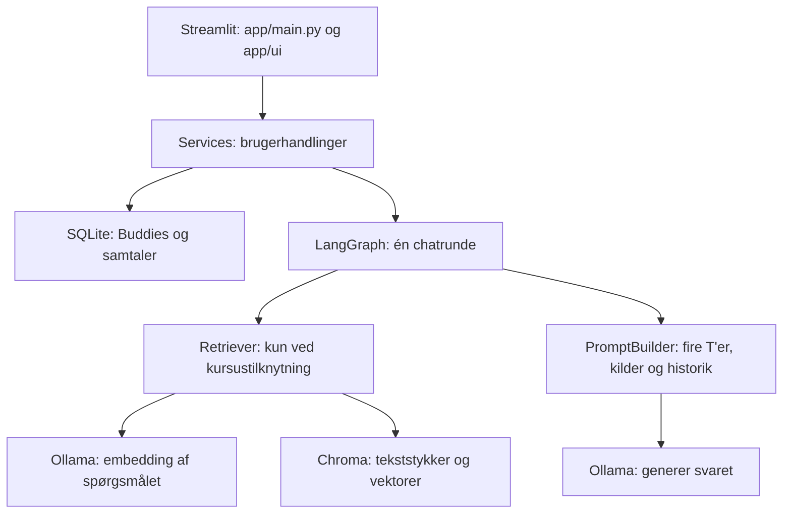

# Forstå koden i StudyGraph

Denne guide beskriver `exam_project/`: en lokal studieassistent, der besvarer spørgsmål med eller uden kursusmateriale. Her er indgangspunktet `app/main.py`.

## Overblik over mapperne

| Mappe                                                                    | Ansvar                                                                                                                                                                      | Hvornår skal du kende den?                                                |
| ------------------------------------------------------------------------ | --------------------------------------------------------------------------------------------------------------------------------------------------------------------------- | -------------------------------------------------------------------------- |
| `app/`                                                                 | Den egentlige StudyGraph-applikation.                                                                                                                                       | Når du vil forstå eller ændre appens adfærd.                           |
| `app/ui/`                                                              | Streamlit-siderne Chat, Buddies og About samt fælles visning og servicekobling.                                                                                            | Ved ændringer i brugerfladen.                                             |
| `app/services/`                                                        | Brugsscenarier: administrer Buddies, start samtaler og gennemfør en chatrunde.                                                                                             | Når du følger en brugerhandling gennem systemet.                         |
| `app/domain/`                                                          | Datamodeller, validering og faste valgmuligheder. Ingen database- eller modelkald.                                                                                          | Når du skal forstå Buddy, snapshot, samtale, besked og søgeresultat.    |
| `app/graph/`                                                           | LangGraph-forløbet, dets tilstand og valget mellem RAG og generel chat.                                                                                                    | Når du skal forklare, hvorfor retrieval bliver kørt eller sprunget over. |
| `app/prompts/`                                                         | Promptbygger og versionerede Markdown-skabeloner.                                                                                                                           | Når du undersøger de fire T'er og modellens instruktioner.               |
| `app/adapters/`                                                        | Forbindelser til SQLite, Ollama og Chroma samt indlæsning og opdeling af dokumenter.                                                                                       | Når du følger data ind og ud af appen.                                   |
| `scripts/`                                                             | Kommandolinjeværktøjer til opsætning, konvertering, indeksering, søgning og afprøvning.                                                                                | Ved klargøring og fejlsøgning uden UI.                                   |
| `tests/unit/`                                                          | Afgrænsede tests af konfiguration, domæne, prompts, routing og dokumentbehandling.                                                                                        | Når du vil se konkrete regler og kanttilfælde.                           |
| `tests/integration/`                                                   | Samspil mellem services og lagring, bl.a. midlertidig SQLite og testobjekter.                                                                                               | Når du undersøger, hvordan delene fungerer sammen.                       |
| `tests/ui/`                                                            | Streamlit-sider afprøvet med `AppTest`.                                                                                                                                  | Ved ændringer i brugerfladen.                                             |
| `docs/architecture/`                                                   | Arkitektur, teknologistak, datamodel og RAG-forløb.                                                                                                                        | Ved behov for baggrund og begrundelser.                                    |
| `docs/design/`                                                         | Produktdesign, brugeroplevelse, Buddy-koncept og sammenligning af RAG/non-RAG.                                                                                              | Når du vil forstå hensigten med funktionerne.                            |
| `docs/requirements/`                                                   | Projektets funktionelle og ikke-funktionelle krav.                                                                                                                          | Når du kontrollerer, hvad løsningen skal kunne.                          |
| `docs/plan/`                                                           | Status, backlog, implementeringsplan, beslutninger og risici.                                                                                                               | Når du vil vide, hvad der er færdigt og hvad der mangler.                |
| `docs/evaluation/`                                                     | Forsøgsbeskrivelser, resultater og prompt-eksempler.                                                                                                                       | Ved eksamensforklaring og vurdering af løsningen.                         |
| `docs/RAG/`                                                            | Beskrivelse af vidensbasen og selve kursusmaterialet.                                                                                                                       | Ved forståelse af datagrundlaget.                                         |
| `docs/RAG/llm_for_developers/source/`                                  | Originalt undervisningsmateriale og undervisningseksempler.                                                                                                                 | Som kilder til konvertering; kodeeksempler her er ikke appens kode.        |
| `docs/RAG/llm_for_developers/llm_friendly/`                            | Bearbejdet Markdown i `week<N>/`-mapper, som indekseringen læser.                                                                                                        | Når du vil se, hvilke tekster appen kan finde.                            |
| `designs/DrawIo/` og `designs/Images/`                               | Diagrammer, designfiler og visuelle eksportfiler.                                                                                                                           | Ved præsentation af design; de køres ikke af appen.                      |
| `regression/`                                                          | Et separat eksperiment om kodegenerering og regression, med egen CLI og Streamlit-side.                                                                                     | Ved den obligatoriske sammenligning; se mappens egen README.               |
| `regression/datasets/`                                                 | Datasæt til regressionsforsøg.                                                                                                                                            | Når du undersøger forsøgenes input.                                     |
| `regression/runs/`                                                     | Gemte prompts, genererede programmer, notebooks og forsøgsresultater. Underinddelt i `cloud/`, `predict/` og `rag/`; RAG-forsøg skelner mellem `cmd/` og `ui/`. | Som dokumentation for faktisk udførte forsøg.                            |
| `data/`                                                                | Lokale runtime-data: `studygraph.db` og `chroma/`.                                                                                                                      | Ved fejlsøgning af lagring; indholdet er ikke kildekode.                  |
| `.streamlit/`                                                          | Streamlit-konfiguration, bl.a. udseende.                                                                                                                                    | Ved ændring af appens opsætning.                                         |
| `.clinerules/`                                                         | Arbejdsregler til kodeassistenter.                                                                                                                                          | Ved udvikling, ikke ved normal brug.                                       |
| `.venv/`                                                               | Python-miljø med installerede pakker.                                                                                                                                      | Administreres gennem `uv`; rediger ikke pakkerne manuelt.                |
| `.pytest_cache/`, `.mypy_cache/`, `.ruff_cache/`, `__pycache__/` | Automatisk oprettede test-, type-, lint- og Python-caches.                                                                                                                  | Ikke nødvendige at læse for at forstå projektet.                        |

`__init__.py` markerer Python-pakker og kan godt være tom. En mappe med sådan en fil er ikke tom og skal ikke slettes af den grund.

## Arkitekturen og de to datalagre



**SQLite** gemmer brugerens data: kurser, Buddies, samtaler og beskeder. **Chroma** gemmer søgbare tekststykker fra kursusmaterialet med embeddings og kildemetadata. **Ollama** leverer både chatmodellen og embeddingmodellen; de løser forskellige opgaver. En embedding er en talvektor til søgning, ikke et genereret svar.

Streamlit, Chroma-serveren og Ollama er tre lokale processer. Streamlit tegner siden igen ved interaktion. Derfor samler og cacher `app/ui/clients.py` services og klienter med `st.cache_resource`, mens den valgte samtale hører til i `st.session_state`.

## Følg ét spørgsmål gennem koden

1. `app/main.py` åbner den valgte side, og `app/ui/chat_page.py` modtager spørgsmålet og den valgte Task.
2. `ChatService.send_message()` i `app/services/chat_service.py` validerer teksten og henter samtale og historik fra SQLite.
3. Servicen sender et `StudyGraphState` til grafen. Tilstanden indeholder samtalens Buddy-snapshot, Task, spørgsmål og historik.
4. `route_by_snapshot()` i `app/graph/build.py` vælger rute ud fra snapshotets `course_id`. Med kursus køres retrieval; uden kursus springes retrieveren helt over.
5. `app/adapters/retriever.py` laver spørgsmålet til en embedding og finder de nærmeste tekststykker i Chroma. Resultatet indeholder tekst, kilder, afstande og en status.
6. `app/prompts/builder.py` samler de fire T'er, eventuel kursuskontekst, historik og det nye spørgsmål. En samtale uden kursus får ingen kursuskontekst, selv hvis kalderen ved en fejl sender tekststykker med.
7. `app/adapters/ollama_client.py` genererer svaret. Grafen kan sende tokens løbende tilbage til UI.
8. Chatservicen gemmer beskederne og metadata som model, promptversion, kilder og retrievalstatus. UI viser svaret og eventuelle kilder.

Generering sker før lagring af beskederne. Bemærk dog, at de to beskeder i den nuværende kode gemmes med separate lagerkald: en databasefejl mellem dem kan efterlade brugerbeskeden alene. Streaming på skærmen er heller ikke i sig selv bevis for, at svaret er gemt.

## Følg kursusmaterialet ind i søgeindekset

```text
source/ → convert_course_material.py → llm_friendly/week<N>/*.md
        → loader.py → chunker.py → embedder.py → Chroma
```

`scripts/ingest.py` styrer indekseringen. Loaderen finder dokumenterne, chunkeren opdeler dem i overlappende tekststykker, og embeddingmodellen beregner vektorer. Tekst, vektorer og kildemetadata gemmes sammen. Stabile chunk-id'er og `upsert` undgår dubletter ved gentagelse med samme input. `--recreate` sletter og genopbygger collectionen; almindelig `upsert` betyder ikke automatisk, at alle gamle tekststykker fra ændrede eller fjernede dokumenter slettes.

Appen indekserer ikke hele kursusmaterialet på ny ved hvert spørgsmål. Den søger i det allerede oprettede indeks. Ændret Markdown kræver derfor en opdatering af indekset, før ændringen kan indgå i svarene.

## De vigtigste filer i læserækkefølge

| Rækkefølge | Fil                                                                      | Det vigtigste at forstå                                                    |
| ------------ | ------------------------------------------------------------------------ | --------------------------------------------------------------------------- |
| 1            | [app/main.py](app/main.py)                                                | Opstart og registrering af de tre sider.                                    |
| 2            | [app/ui/clients.py](app/ui/clients.py)                                    | Hvor lager, model, retriever, promptbygger, graf og services kobles sammen. |
| 3            | [app/config.py](app/config.py)                                            | Miljøvariabler, standardværdier, modeller, endpoints og datastier.        |
| 4            | [app/domain/buddy.py](app/domain/buddy.py)                                | Forskellen mellem den genbrugelige Buddy og samtalens frosne snapshot.      |
| 5            | [app/services/chat_service.py](app/services/chat_service.py)              | Hele brugsscenariet fra besked til gemt svar.                               |
| 6            | [app/graph/build.py](app/graph/build.py) og [state.py](app/graph/state.py) | Routing, noder og data, som sendes mellem trinene.                          |
| 7            | [app/prompts/builder.py](app/prompts/builder.py)                          | De fire T'er, grounding-regler og rækkefølgen af modelbeskeder.           |
| 8            | [app/adapters/retriever.py](app/adapters/retriever.py)                    | Søgning og skelnen mellem fund, tomt resultat og fejl.                     |
| 9            | [app/adapters/sqlite_store.py](app/adapters/sqlite_store.py)              | Databaseskema, serialisering og lagring.                                    |
| 10           | [scripts/ingest.py](scripts/ingest.py)                                    | Hvordan kursusviden bliver søgbar.                                         |

De centrale forløb i opstart, servicekobling, chatservice, graf, promptbygger og indeksering er inddelt med danske kommentarer. Docstrings og identifiers følger den eksisterende kode. Promptskabelonernes indhold og programmets adfærd er ikke ændret som led i denne guide.

## Det skal du kunne forklare om koden

- **De fire T'er:** Task er opgaven for den enkelte besked. Tone er svarstilen, Traits er Buddyens egenskaber, og Target er målgruppen. De sidste tre gemmes i Buddy-snapshotet.
- **Snapshots:** En ny samtale får en kopi af Buddyens indstillinger. Redigering af Buddyen ændrer derfor ikke gamle samtaler. `frozen=True` beskytter datamodellen mod almindelig feltændring.
- **RAG og non-RAG:** Forskellen afgøres af kursustilknytningen. Begge ruter bruger promptbyggeren og chatmodellen; kun RAG-ruten henter kursustekst.
- **Retrievalstatus:** `ok` betyder, at tekststykker blev fundet; `empty` betyder ingen fund; `failed` betyder en teknisk fejl; `skipped` betyder, at retrieval ikke blev kørt. `ok` garanterer ikke, at modellen svarer korrekt.
- **Fejl og grounding:** Ved retrievalfejl returnerer adapteren `failed`. Den nuværende graf går stadig videre til promptbygger og generering med tom kontekst. Prompten må derfor ikke påstå, at svaret bygger på fundet kursusmateriale; fejlen skal kunne ses særskilt i status.
- **Kilder og begrænsninger:** Kildereferencer følger de faktisk hentede tekststykker. RAG reducerer ikke behovet for at kontrollere svar, og tekst fra dokumenterne skal behandles som data frem for instruktioner.
- **Lagdeling og testbarhed:** Domænet beskriver reglerne, services udfører brugerhandlinger, grafen styrer rækkefølgen, og adapterne håndterer eksterne systemer. Interfaces i `app/adapters/protocols.py` gør det muligt at teste med fakes.
- **En fair sammenligning:** Hold spørgsmål, historik, fire T'er, model og generationsindstillinger ens, når effekten af retrieval skal vurderes. Regressionseksperimenterne i `regression/` har deres eget datagrundlag og må ikke forveksles med appens kursusindeks.

Prøv at forklare: Hvorfor kaldes retrieveren aldrig uden kursus? Hvorfor ændrer en Buddy-redigering ikke en gammel samtale? Hvad sker der, hvis Chroma er slukket? Hvilke data gør et svar sporbart? Kan du besvare det ved at pege på ovenstående filer, kender du de vigtigste sammenhænge.

## Praktiske kommandoer

Kør fra `exam_project/` i PowerShell. Den fulde opsætning findes i [README.md](README.md).

```powershell
uv run python .\scripts\doctor.py
uv run pytest -q
uv run ruff check .
uv run mypy app
uv run streamlit run app/main.py
```

Appen kræver Ollama og Chroma for en rigtig RAG-chat. Tests bruger testobjekter og midlertidige lagre, så en grøn testkørsel ikke dokumenterer, at de lokale servere kører eller at kursusindekset er opdateret.

## Tomme mapper

Ved gennemgangen blev én tom mappe fundet uden for de udeladte miljø- og cachemapper: `data/chroma/2a146e5a-b39c-4d64-bba2-b4fef44b000b/`. Den er bevaret, fordi Chroma ejer sin interne lagerstruktur, og projektets regler beskytter `data/chroma/` mod oprydning uden genindeksering. Der blev ikke fundet tomme kildekode- eller dokumentationsmapper. Miljø, caches, binære filer og genererede workspace-kørsler er ikke gennemgået indholdsmæssigt.

Læs videre i [arkitekturen](docs/architecture/architecture.md), [teknologistakken](docs/architecture/tech-stack.md), [datamodellen](docs/architecture/data-model.md) og [regressionseksperimentets README](regression/README.md).
